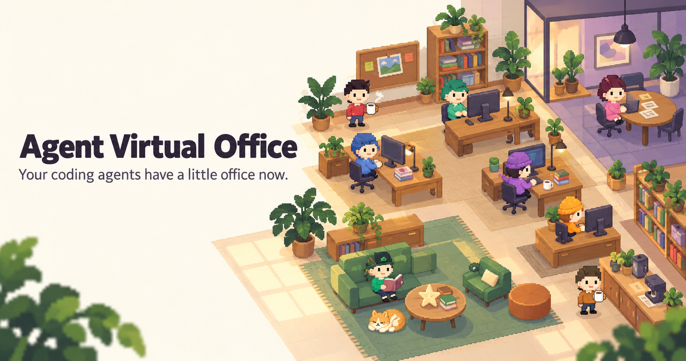
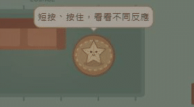
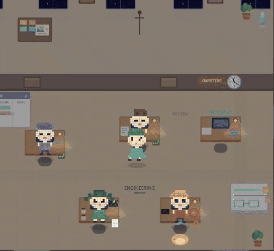

# Posters & GIF files

The posters are AI-generated promotional illustrations with a distinct artistic interpretation of Agent Virtual Office; they are not UI screenshots. The GIFs show the actual Traditional Chinese interface.

## Posters

| Asset | Preview / download |
|---|---|
| Wide poster (1729 × 910) | [Download office-wide.png](office-wide.png) |
| Square poster (1254 × 1254) | [Download office-square.png](office-square.png) |

## Interface GIFs

| Asset | What it shows |
|---|---|
| [paper-star.gif](paper-star.gif) | A single long press (about 1500 ms) and spring release. 280 × 155, 7 frames, 6.12 seconds. |
| [postcard.gif](postcard.gif) | Open the postcard, select the Cat sticker, and close the preview. 545 × 500, 6 frames, 8 seconds. The GIF does not show a download. |

The GIFs were captured from the actual Traditional Chinese UI using the normal runtime at `f09c120` and the existing local service on port `5187`; they do not use mock data. Clips are edited for pacing. For the exact poster prompts and image-generation mode, see [generation-prompts.json](generation-prompts.json). Temporary blank capture artifacts were removed; only the reviewed final captures are listed here.
